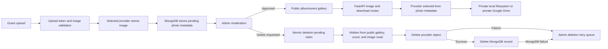

# Wedding Memories — Phase 7 Final Report

Date: 2026-11-08

## Executive status

Phase 7 reliability engineering and automated validation are **Completed**. Live Atlas health, Google Drive readiness, and an isolated local-storage adapter smoke test were **Verified**. The complete authenticated photo lifecycle against the connected development account and the requested browser/mobile viewport matrix are **Not verified**. Do not treat this report as approval to deploy; complete the remaining authenticated/manual checks and Phase 8 deployment hardening first.

## Completed implementation changes

- Permanent photo deletion now sets `deletion_state=pending` atomically before removing storage. This is independent of moderation `status`; legacy photo documents without the field remain active.
- Public album/event galleries, photo counts, and public image delivery exclude deletion-pending records immediately. The admin photo page has a dedicated deletion retry view and retry action.
- Deletion uses a five-minute claim lease to avoid concurrent provider deletes and to allow recovery after process interruption. Storage failures and MongoDB metadata deletion failures leave the photo hidden and retryable. The provider stored on the photo record determines which adapter is used.
- Local storage writes are offloaded from the async request loop, flushed to a temporary file, and atomically renamed. Failure cleanup removes the temporary file. Local metadata, deletion, and reads also offload filesystem work where applicable.
- Uvicorn access-log records for the Google OAuth callback redact the complete query string. The README now calls out proxy/hosting log redaction as a separate requirement.
- No Redis configuration or client existed. The in-memory rate limiter remains optional for development; the multi-instance limitation and production decision are documented.
- Updated backend documentation with storage/deletion behavior, recovery steps, startup, and Phase 8 Render/Vercel requirements.

## Files changed

- Backend: `app/api/v1/admin_photos.py`, `app/api/v1/public.py`, `app/main.py`, `app/storage/local.py`, and new `app/middleware/oauth_log_redaction.py`.
- Backend tests: `tests/test_albums.py`, `tests/test_photo_management.py`, `tests/test_public_uploads.py`, `tests/test_google_drive.py`, and new `tests/test_oauth_log_redaction.py`.
- Frontend: `src/services/photoService.ts`, `src/pages/admin/AdminPhotosPage.tsx`, and `src/test/AdminPhotos.test.tsx`.
- Documentation: `backend/README.md` and this report.

No `.env`, JWT or OAuth secret, production configuration, photo, or existing MongoDB photo record was edited. The live Drive readiness check updates the integration's ordinary last-successful-check metadata and may refresh an expired access token through the existing OAuth refresh flow. It did not change the saved storage provider or disconnect Drive. No schema migration or index change was made; new deletion metadata is written only when deletion is requested.

## Storage and deletion lifecycle

Local and Drive image preview/download continue through FastAPI. Drive files remain private. Missing local files and confirmed Drive 404 responses are treated as already absent, allowing metadata cleanup to be retried safely. A repeated DELETE while a claim is active returns 409; a retry after a failed operation can reclaim the record. After the record is fully removed, a later DELETE returns 404.

## Validation results

| Check | Result |
|---|---|
| Complete backend test suite | **69 passed** |
| Complete frontend test suite | **24 passed** across 5 files |
| Python compilation | **Passed** (`compileall`) |
| TypeScript checks | **Passed** (`tsc -b`, run by production build) |
| Frontend production build | **Passed** (Vite) |
| Lint | **Not configured** (`npm` has no lint script; backend has no configured linter in requirements) |
| Live FastAPI health / Atlas connection | **Passed**; local `/health` reported healthy and database connected |
| Live Google Drive connection/folder check | **Passed**; connected and folder ready; provider remained `google_drive` |
| Temporary local storage smoke test | **Passed**; generated PNG upload, metadata, retrieval, and deletion; temp directory removed |
| Live local photo upload through guest API | **Not verified** |
| Live Drive photo upload/preview/download/deletion | **Not verified in this cycle** |
| Mixed-provider public gallery and browser lightbox | **Mocked/API regression coverage passed; live browser verification not performed** |
| Live moderation/restore/bulk approval/deletion | **Mocked regression coverage passed; live account test not performed** |
| Mobile/browser viewport matrix | **Not verified** |

The mocked backend coverage includes local upload/read and failure cleanup, metadata insertion failure cleanup, Google Drive private upload/delivery/provider selection and delete behavior, mixed-provider gallery and download responses, token refresh and invalid-refresh behavior, token encryption/rotation, OAuth state, moderation, retryable deletion, deletion concurrency, and log redaction.

## Live verification limits

The local FastAPI server was started only on `127.0.0.1:8011` for a health check and then stopped. Atlas responded healthy. A read-only state check showed the saved provider was Google Drive and encrypted Drive credentials were present; `verify_connection()` reported the Drive folder ready. The temporary filesystem smoke test used an isolated OS temp directory and removed it on completion.

No `PHASE7_VALIDATION_TEST` album/event or test photos were created, so there was nothing to clean up and no destructive live operation occurred. The authenticated admin UI could not be used for the requested end-to-end writes: browser computer-use inspection was stopped by Escape, and no authenticated admin session or password was provided for a normal login. I did not mint an admin token or bypass password authentication to continue. The live Drive upload, moderation, mixed-provider gallery, delete, and restoration steps therefore remain **Not verified**. The connected Drive readiness check is not evidence of an end-to-end photo upload.

The user stopped Computer Use during browser inspection. No further browser actions were taken. Consequently, viewport checks at 393×852, 412×924, 360×800, 320×700, 430×932, 768×1024, and 1440×900, plus camera picker, lightbox, and browser download behavior, remain **Not verified**. No existing album, event, wedding photo, or Drive file was modified or deleted.

## Security and operations review

- Admin routes remain protected by the existing administrator dependency; guest uploads continue to use event-bound, short-lived upload tokens.
- Local storage is not exposed as a static public directory. Image responses continue to dispatch by each photo's stored provider.
- OAuth code/state query values are redacted from Uvicorn access logs. Configure any Render/reverse-proxy access logging to omit or redact callback query strings; hosting logs are outside the app filter's control.
- Rate limits still run in process memory. They reset on restart and are not shared between instances. Do not treat them as coordinated multi-instance abuse protection.
- Failed permanent deletions are hidden from guests and exposed in the admin **Deletion retry** view. No background deletion worker is implemented; retries are administrator initiated.
- Disconnecting Google Drive still makes existing Drive-backed photos unavailable until the same account is reconnected. Do not disconnect as a refresh test.

## Phase 8 production configuration requirements

1. **Render backend:** root `backend`; build `pip install -r requirements.txt`; start `uvicorn app.main:app --host 0.0.0.0 --port $PORT`. Configure server-side `MONGODB_URI`, `MONGODB_DATABASE`, strong `JWT_SECRET` (32+ random bytes), `APP_ENV=production`, `DEBUG=false`, explicit `FRONTEND_ORIGINS`, and the required `GOOGLE_DRIVE_CLIENT_ID`, `GOOGLE_DRIVE_CLIENT_SECRET`, exact `GOOGLE_DRIVE_REDIRECT_URI`, and `GOOGLE_DRIVE_TOKEN_ENCRYPTION_KEY` when Drive is used. Never put backend secrets in Vercel variables or source control.
2. **Vercel frontend:** set `VITE_API_BASE_URL` to the HTTPS backend URL ending in `/api/v1`, and `VITE_PUBLIC_APP_URL` to the exact HTTPS frontend origin for guest and QR links.
3. **CORS and transport:** allow only the exact Vercel origin(s), no wildcard. Serve all public pages and APIs over HTTPS; this is required for mobile camera capture.
4. **Google OAuth:** register the exact HTTPS callback URL in Google Cloud Console, configure the audience/test users or complete the required publishing/verification, retain the `drive.file` scope, keep Drive files private, and preserve/backup the Fernet encryption key independently from JWT secrets.
5. **Persistence:** Google Drive is durable across backend restarts. If local storage is selected on Render, mount persistent storage and set `PHOTO_STORAGE_LOCAL_PATH` to that mount. Back up local files and MongoDB metadata together.
6. **Scaling:** Redis is not currently an application dependency. Until a shared limiter is implemented and configured, run one backend instance if relying on the current upload limits; add host-level body/request limits as well.
7. **Readiness:** monitor `/health`, database and adapter failures, OAuth/proxy log redaction, and the admin deletion retry queue. Validate backups, restore, and Drive reconnection before public launch. Do not deploy from this Phase 7 report.

## Remaining work

**Partially completed:** live Atlas/Drive readiness and local adapter checks. **Not verified:** end-to-end local/Drive uploads, delivery, downloads, moderation, deletion/retry against only disposable live records, and the mobile viewport matrix. These checks require a normal authenticated admin session and browser QA. Redis-backed multi-instance limits and an automatic deletion worker are not implemented; use the documented operating constraints until separately designed and validated.
